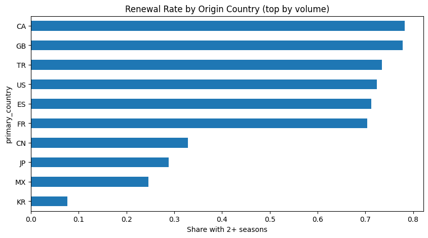
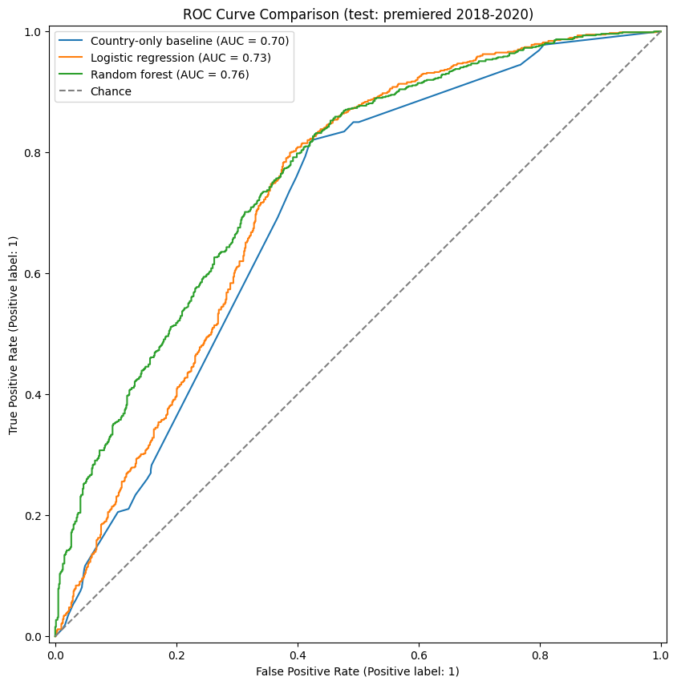

# Predicting Whether a TV Series Gets a Second Season

**How much of a TV show's renewal can be predicted from public information alone?** Studios and streamers decide renewals using private data such as viewership, completion rates, and production costs. Independent producers, investors, and analysts have to judge the same bet using only what is public. This project tests how far public launch-time metadata can go, using 7,424 scripted series from The Movie Database (TMDb).

📓 [Notebook](DSC680%20Project%202%20code.ipynb) · 📄 [White paper (PDF)](DSC680%20Project%202%20Milestone%203%20Whitepaper%20-%20Luera.pdf) · 📊 [Slides (PDF)](DSC680%20Project%202%20Milestone%203%20PPT%20-%20Luera.pdf)

---

## Key Findings

- **Public metadata predicts renewal, but modestly.** On shows that premiered in 2018–2020, a Random Forest reached a ROC-AUC of 0.762, compared with 0.50 for chance and 0.700 for a simple lookup of each show's country.
- **Where a show is made matters most.** About 9% of Korean shows reached a second season, compared with 26–27% of Japanese, Chinese, and Mexican shows and 71–78% of US, UK, Canadian, and Australian shows.
- **That gap reflects format, not quality.** Many Korean dramas, Japanese series, and telenovelas are designed as a single run, so the model mostly learns which shows were *built* for more than one season, not which ones audiences kept watching.
- **Everything else adds little.** Shuffling country and language cut the model's AUC by 0.202. Genre, network, runtime, and premiere timing each cut it by 0.022 or less.
- **The results held up under robustness checks.** AUC stayed between 0.756 and 0.769 when premiere year was removed and when only explicit cancellations counted as "not renewed."

*Share of shows reaching a second season, by country of origin (KR = Korea, MX = Mexico, JP = Japan, CN = China).*

## Research Questions

1. **Can metadata available around a show's debut predict whether it gets a second season?** Yes, modestly (AUC 0.762).
2. **Which features are the strongest predictors?** Country and language, by a wide margin.
3. **Do renewal rates and model errors differ across platforms, genres, and countries?** Yes, mostly by country. The model is weaker for Western shows (AUC 0.673) than for all others (0.768), and it over-predicts renewal in both groups. Platforms could only be compared through each show's primary network.

## Results

| Model | ROC-AUC (95% interval) | Accuracy | F1 |
|-------|------------------------|----------|-----|
| Always predict the majority class | 0.500 | 0.494 | n/a |
| Country-only lookup | 0.700 (0.674–0.724) | 0.695 | 0.726 |
| Logistic regression | 0.728 (0.701–0.752) | 0.702 | 0.728 |
| **Random forest** | **0.762 (0.738–0.785)** | 0.697 | **0.737** |

The Random Forest's +0.062 AUC gain over the country lookup is statistically supported (bootstrap 95% interval +0.045 to +0.079), but accuracy is nearly the same, so most of the practical value comes from knowing the country.

## Data

| Dataset | Role |
|---------|------|
| [Full TMDb TV Shows Dataset](https://www.kaggle.com/datasets/asaniczka/full-tmdb-tv-shows-dataset-2023-150k-shows) | Primary table: genres, networks, countries, languages, runtimes, and season counts |
| [TMDb TV Series Details](https://www.kaggle.com/datasets/bourdier/all-tv-series-details-dataset) | Cross-checks which shows are still running |
| [TV Shows on Netflix, Prime Video, Hulu and Disney+](https://www.kaggle.com/datasets/ruchi798/tv-shows-on-netflix-prime-video-hulu-and-disney) | Description only (matched just 27.7% of shows) |

**Target:** Whether a show reached two or more seasons (58.3% did). Starting from 168,639 raw rows, the final dataset keeps scripted series that premiered by the end of 2020 and have at least 10 user votes, and it removes one-season shows that are still running because their outcome isn't known yet.

## Approach

1. **Building a trustworthy label.** Most raw titles are obscure (the median show has 0 votes and 1 season), so filters were applied and tested across nine combinations of premiere cutoff and vote threshold. The regional pattern held in every one.
2. **Preventing leakage.** Season and episode counts, votes, popularity, ratings, status, and platform flags all describe a show's entire run, so none were used as features.
3. **Engineering 71 launch-time features:** genre, network, country, language, runtime, number of creators, and premiere year and month. Category lists were learned from training data only.
4. **Splitting by time.** Models trained on shows that premiered through 2017 and were tested once, with no tuning, on 2018–2020 premieres.
5. **Modeling and evaluation.** Logistic regression and a Random Forest were compared against two baselines, with bootstrap confidence intervals and grouped permutation importance to measure which kinds of features mattered.
6. **Robustness and fairness checks.** Results were tested without premiere year, with cancellations-only labels, and separately for Western and non-Western shows.

## Ethical Considerations

The model learns that non-Western shows are "less likely to be renewed" because of how they're made, which could easily be misread as a judgment on them. To guard against that, results are framed as associations, performance is reported by region, and no individual show, creator, or cast member is named or scored. The model is intended for benchmarking and teaching, not for deciding whether any show should be renewed, funded, or canceled.

## Next Steps

- Use survival analysis to properly handle shows that are still running
- Add first-season audience signals, such as early ratings, from sources that record when each value was observed
- Build separate models for Western and non-Western markets, and recalibrate predictions for later years
- Try gradient boosting and features from show synopses

## Tools

Python · pandas · NumPy · scikit-learn · matplotlib · Jupyter

---

*Completed November 2026 for DSC 680 (Applied Data Science).*
